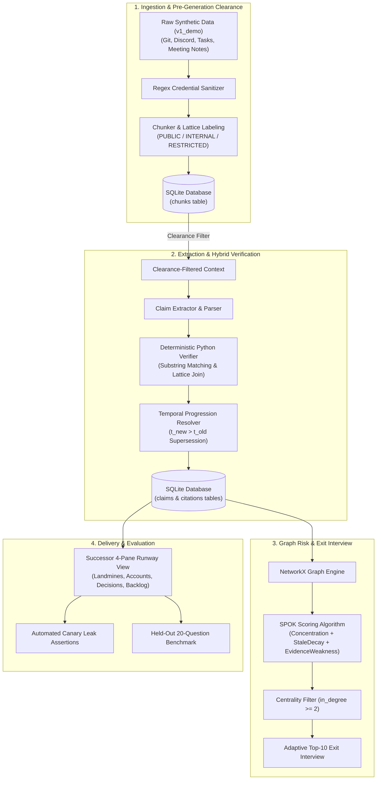

# HandoffLedger: Verifiable Knowledge Handover Pipeline

**HandoffLedger** replaces unverified narrative handover summaries with an evidence-linked claim ledger, a graph-based single-point-of-knowledge (SPOK) risk engine, a permission-enforcing security lattice, and an objective held-out evaluation harness.

---

## System Architecture



---

## Core Formulas

### Single-Point-of-Knowledge (SPOK) Formula
$$\text{SPOK}(n) = 0.5 \times \text{Concentration}(n) + 0.25 \times \text{StaleDecay}(n) + 0.25 \times \text{EvidenceWeakness}(n)$$

Where:
- $\text{Concentration}(n)$: Ratio of entity knowledge authored by the departing member ($w(\text{git})=1.0, w(\text{pr})=0.9, w(\text{task})=0.7, w(\text{doc})=0.6, w(\text{chat})=0.5$).
- $\text{StaleDecay}(n) = 1.0 - \exp\left(-\frac{\ln(2)}{60} \cdot \Delta t\right)$ with half-life $t_{1/2} = 60\text{ days}$.
- $\text{EvidenceWeakness}(n)$: Penalty average ($\text{verified}=0.0, \text{inferred}=0.4, \text{conflicting}=0.8, \text{missing\_evidence}=1.0$).
- Centrality Filter: In-degree $< 2$ suppresses peripheral single-commit nodes from heatmaps and interview queues.

---

## Quickstart

### 1. Run Automated Test Suite
```bash
PYTHONPATH=. pytest tests/ -v
```

### 2. Start Backend API
```bash
python3 -m uvicorn backend.app.main:app --host 127.0.0.1 --port 8000
```
API Documentation: [http://127.0.0.1:8000/docs](http://127.0.0.1:8000/docs)

### 3. Start Frontend Dashboard
```bash
cd frontend
npm install
npm run dev
```
Dashboard: [http://127.0.0.1:5173/](http://127.0.0.1:5173/)
